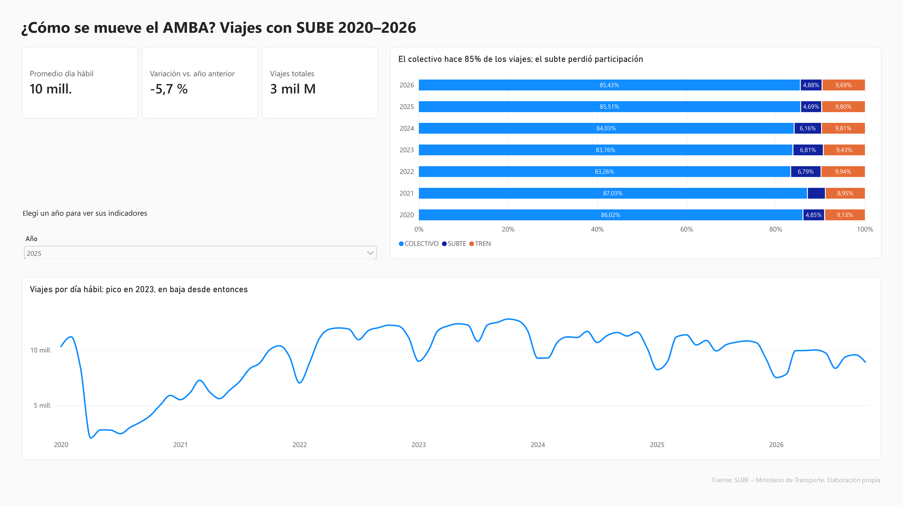
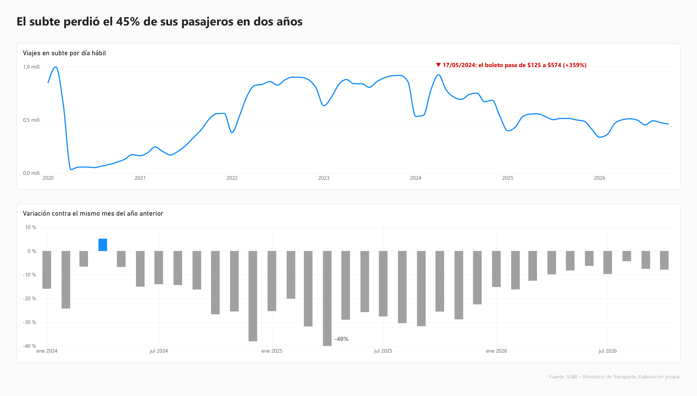
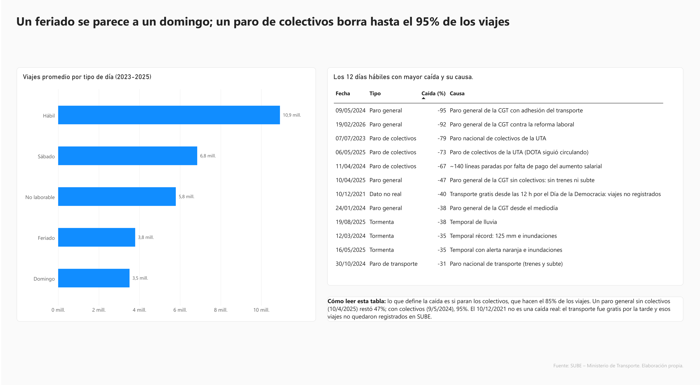

# ¿Cómo se mueve el AMBA? 19.000 millones de viajes con SUBE (2020–2026)

**El AMBA viaja un 22% menos que en 2023, y el subte perdió el 45% de sus pasajeros de día hábil en dos años, después del aumento de tarifa de mayo de 2024.**

Análisis de los registros diarios de SUBE del Ministerio de Transporte, de punta a punta: carga y limpieza en PostgreSQL, modelo en estrella, preguntas de negocio en SQL y dashboard en Power BI. El pipeline también está replicado en PySpark para Databricks.

**🔎 Explorá los datos vos:** [carobailon.github.io/sube-amba](https://carobailon.github.io/sube-amba/). Evolución por modo, el subte por línea, un buscador de colectivos y los días atípicos, sin instalar nada. Cómo está hecha y por qué: [web/README.md](web/README.md).



## Hallazgos

| # | Hallazgo | Dato |
| --- | --- | --- |
| 1 | **La demanda tocó su máximo en 2023 y cae desde entonces.** | 11,7 millones de viajes por día hábil en 2023 → 9,1 millones en 2026 (-22%). |
| 2 | **El subte perdió el 45% de sus pasajeros.** La caída arranca con el aumento del 17/05/2024 ($125 → $574, +359%) y se profundiza durante un año. | 915.000 viajes por día hábil en oct-2023 → 500.000 en oct-2025. Peor mes: abr-2025 (-40% interanual). |
| 2b | **La caída del subte no fue pareja entre líneas.** | Oct-2023 → oct-2026: la D, la A y la B perdieron más de la mitad de sus pasajeros (-55%, -53%, -53%); la H fue la que mejor se sostuvo (-37%). Total del subte: -50%. |
| 3 | **El colectivo sostiene la red.** | 85% de los viajes. El subte bajó del 6,8% (2023) al 4,7% (2025). |
| 4 | **Un feriado se comporta como un domingo, pero un "puente" no.** | Feriado -65% y domingo -68% vs. día hábil; día no laborable con fines turísticos, -47%. |
| 5 | **Lo que define el impacto de un paro es si paran los colectivos.** | Paro general con colectivos (9/5/2024): -95% de viajes. Sin colectivos (10/4/2025): -47%. Una tormenta fuerte resta entre 35% y 38%. |

**Hallazgo de calidad de datos:** el 10/12/2021 aparece como una caída del 40%, pero no lo es. Ese día el transporte fue gratuito desde el mediodía por el acto del Día de la Democracia, y esos viajes no quedaron registrados. El subte, que no fue gratuito, subió un 9%. **SUBE mide viajes pagos, no viajes totales.**

## Recomendaciones

1. **Programar los días "puente" con frecuencia de sábado, no de domingo.** En un puente viaja un 47% menos que en un día hábil, pero en un feriado un 65% menos: muchas personas igual trabajan. Una frecuencia de domingo deja sin servicio a buena parte de esa demanda.
2. **Centrar los planes de contingencia ante paros en el colectivo.** Cuando paran los colectivos se pierde entre el 73% y el 95% de los viajes; cuando paran solo trenes y subte, alrededor del 47%. Los refuerzos y la comunicación a usuarios rinden más si se activan según adhiera o no la UTA.
3. **Antes de un nuevo aumento del subte, averiguar a dónde fueron sus pasajeros.** Tras el aumento de 2024 el subte perdió el 45% de sus viajes de día hábil y en 2026 todavía no se recupera. Estos datos no permiten saber si esas personas se pasaron al colectivo o dejaron de viajar: hace falta una encuesta origen-destino o datos de combinaciones.
4. **Fiscalizar con muestras amplias, no solo en las líneas grandes.** Hacen falta 183 de 391 líneas para llegar al 80% de los viajes: la demanda está repartida y controlar solo las 10 líneas más grandes cubre apenas el 12%.
5. **Marcar en el dataset público los días de transporte gratuito.** Hoy aparecen como caídas de demanda (10/12/2021: -40%) y cualquier análisis automático los lee como anomalías.

## Limitaciones

- **Usos no son personas.** Una persona que combina colectivo y tren cuenta dos veces; el dataset no permite contar pasajeros únicos.
- **SUBE registra viajes pagos.** Los viajes gratuitos o sin validar no aparecen.
- **La relación entre tarifa y caída del subte es temporal, no causal.** La caída coincide con el aumento y sigue sus fechas tramo por tramo, pero en el mismo período hubo otros cambios (poder adquisitivo, actividad económica, aumentos en otros modos) que también pueden influir. No hay un grupo de control para aislar el efecto de la tarifa.
- **2026 está incompleto (hasta el 30/10) y tiene datos preliminares** desde febrero, que pueden corregirse. Por eso los años se comparan con promedios diarios.
- **El municipio falta en el 60% de los registros.** No se puede hacer un análisis confiable por municipio con este dataset.
- **Algunas líneas se informan agrupadas** (por ejemplo, la 501G de Moreno), lo que exagera su tamaño en el ranking.

El detalle de cada decisión de limpieza está en [docs/decisiones_de_limpieza.md](docs/decisiones_de_limpieza.md).

## Dashboard

Archivo: [`dashboard/sube_amba.pbix`](dashboard/sube_amba.pbix) · Versión en PDF: [`docs/sube_amba.pdf`](docs/sube_amba.pdf)

**También en Excel:** [`dashboard/sube_amba.xlsx`](dashboard/sube_amba.xlsx) reproduce los hallazgos principales con fórmulas (`SUMIFS`, `COUNTIFS`, `INDEX`/`MATCH`, `MINIFS`), una tabla dinámica por año y modo, la evolución mensual del subte con su variación interanual y gráfico, y los días atípicos.

| Página | Qué muestra |
| --- | --- |
| **Resumen** | Indicadores por año, evolución mensual desde 2020 y reparto entre colectivo, tren y subte |
| **El subte** | Evolución mensual con el aumento de tarifa marcado y variación interanual desde 2024 |
| **Días atípicos** | Demanda por tipo de día y los 12 días hábiles con mayor caída, con su causa |




### Diccionario de indicadores

Todas las medidas DAX del modelo, con su fórmula y cómo leerlas.

| Indicador | Fórmula DAX | Qué significa |
| --- | --- | --- |
| **Usos** | `SUM(fact_usos_amba[cantidad])` | Cantidad total de viajes pagos con SUBE en el período y filtro elegidos. Cuenta viajes, no personas: quien combina colectivo y tren suma dos. |
| **Días con datos** | `DISTINCTCOUNT(fact_usos_amba[fecha])` | Cantidad de días con registros. Se usa como denominador de los promedios. |
| **Promedio diario** | `DIVIDE([Usos], [Días con datos])` | Viajes por día. Permite comparar años completos con 2026, que está incompleto. |
| **Promedio día hábil** | `CALCULATE([Promedio diario], dim_fecha[tipo_dia] = "Hábil")` | Viajes por día hábil, sin fines de semana ni feriados. Es el indicador principal porque el mix de días cambia de un año a otro. |
| **Var. interanual %** | `VAR actual = [Promedio día hábil]`<br>`VAR anterior = CALCULATE([Promedio día hábil], SAMEPERIODLASTYEAR(dim_fecha[fecha]))`<br>`RETURN DIVIDE(actual - anterior, anterior)` | Cuánto cambió el promedio de día hábil contra el mismo período del año anterior. Ejemplo: -40% en abril de 2025 significa que el subte movió un 40% menos de viajes por día hábil que en abril de 2024. |
| **% del total** | `DIVIDE([Usos], CALCULATE([Usos], ALL(dim_linea[modo])))` | Participación de cada modo (colectivo, tren, subte) sobre el total de viajes del período. |

**Modelo en Power BI:** `fact_usos_amba` se relaciona con `dim_fecha` (por `fecha`) y con `dim_linea` (por `linea_key`), ambas relaciones muchos a uno con filtro en una dirección. `dias_atipicos` es una tabla de referencia con la causa de cada caída. La limpieza se hace toda en SQL, así que Power Query solo carga los CSV de `dashboard/datos/` y define los tipos de dato. De esta forma, las reglas de negocio quedan en un único lugar, versionado.

## Datos

- **Fuente:** [SUBE – Cantidad de transacciones (usos) por fecha](https://datos.transporte.gob.ar/dataset/sube-cantidad-de-transacciones-usos-por-fecha), Ministerio de Transporte.
- 3,2 millones de registros diarios por línea y empresa, del 01/01/2020 al 30/10/2026, de todo el país. El análisis se centra en el AMBA.
- Feriados nacionales armados a partir de las comunicaciones del BCRA.
- Causas de los días atípicos verificadas en medios de prensa.

## Cómo está hecho

```
CSV (7 archivos) ──► raw (texto crudo) ──► stg (limpio) ──► dw (modelo en estrella) ──► Power BI
                   01_cargar_crudos     02_limpiar        03_modelo_estrella        06_exportar_powerbi
                                                          04_controles_calidad
                                                          05_preguntas_negocio
```

- **PostgreSQL:** carga, limpieza, modelado y 8 preguntas de negocio (CTEs, funciones de ventana como `LAG`, `SUM OVER`, promedios móviles, y comparación contra un grupo de control).
- **Modelo en estrella:** `fact_usos` + `dim_fecha` (con feriados y tipo de día) + `dim_linea` + `dim_empresa`.
- **Power BI:** modelo con relaciones, medidas DAX (promedio por día hábil, variación interanual con `SAMEPERIODLASTYEAR`, % del total) y 3 páginas.
- **PySpark + Databricks:** el mismo pipeline en arquitectura de medallón (bronze → silver → gold) con tablas Delta. Una validación cruzada confirma que da exactamente los mismos resultados que PostgreSQL. Ver [spark/README.md](spark/README.md).

### El desafío de limpieza principal

La misma línea aparece con nombres distintos según el año. Cuando 31 líneas de colectivo pasaron de jurisdicción nacional a la Ciudad (enero de 2025), la línea 39 pasó de llamarse `BSAS_LINEA_039` a `CABA_LINEA_39`. Construí una clave canónica que unifica 512 nombres en 453 líneas del AMBA y permite seguirlas en el tiempo. Todas las decisiones están en [docs/decisiones_de_limpieza.md](docs/decisiones_de_limpieza.md).

### Controles de calidad

El total de usos se verifica en cada etapa (crudo − descartado = modelo final), sin días faltantes en el calendario. Ver `sql/04_controles_calidad.sql`. El análisis de días atípicos (P6) además detectó un feriado nacional que faltaba en la tabla de feriados (02/09/2022), que se corrigió.

## Preguntas de negocio (`sql/05_preguntas_negocio.sql`)

1. ¿Volvió el AMBA a viajar como antes de la pandemia?
2. ¿Cómo se reparte la demanda entre colectivo, tren y subte?
3. ¿Cuánto cae la demanda en feriados y fines de semana?
4. ¿Qué líneas concentran la demanda? *El 80% de los viajes lo hacen 183 de 391 líneas: la demanda está menos concentrada que la regla 80/20.*
5. ¿Cómo evolucionó el subte y cuánto cambió contra el año anterior?
6. ¿Qué días hábiles tuvieron caídas anómalas y por qué?
7. ¿Cambió la demanda de las 31 líneas traspasadas a la Ciudad? *No: -1,7% contra -2,5% del resto en el mismo período.*
8. ¿La caída del subte fue pareja en todas las líneas? *No: entre octubre de 2023 y octubre de 2026, la D, la A y la B cayeron más del 53%; la H, 37%.*

## Cómo reproducirlo

Ver [docs/instalacion_windows.md](docs/instalacion_windows.md). En resumen: instalar PostgreSQL, copiar los CSV en `data/raw/` y ejecutar `ejecutar_todo.bat`. Los archivos que usa Power BI están en `dashboard/datos/` (se regeneran con `sql/06_exportar_powerbi.sql`).

Para la versión en Databricks Free Edition, ver [spark/README.md](spark/README.md).

## Estructura

```
sube-amba/
├── data/
│   ├── raw/                     ← los CSV de SUBE (no se suben a GitHub por tamaño)
│   ├── feriados_ar.csv
│   └── dias_atipicos.csv        ← causas de los 12 días atípicos
├── sql/
│   ├── 01_cargar_crudos.sql
│   ├── 02_limpiar.sql
│   ├── 03_modelo_estrella.sql
│   ├── 04_controles_calidad.sql
│   ├── 05_preguntas_negocio.sql
│   └── 06_exportar_powerbi.sql
├── spark/                       ← el mismo pipeline en PySpark para Databricks (bronze/silver/gold)
├── dashboard/
│   ├── sube_amba.pbix
│   ├── sube_amba.xlsx           ← el análisis en Excel (fórmulas + tabla dinámica)
│   ├── 01_resumen.png, 02_subte.png, 03_dias_atipicos.png
│   └── datos/                   ← CSV que usa Power BI (solo AMBA)
├── web/
│   ├── exportar_datos.py        ← genera los JSON de la página desde dashboard/datos/
│   └── README.md                ← decisiones de diseño de la página
├── docs/                        ← lo que publica GitHub Pages
│   ├── index.html, app.js, estilos.css   ← la página interactiva
│   ├── data/                    ← datos agregados para la página (≈340 KB)
│   ├── decisiones_de_limpieza.md
│   ├── instalacion_windows.md
│   └── sube_amba.pdf            ← el dashboard exportado a PDF
└── ejecutar_todo.bat
```

---
Carolina Bailon Trujillo · [LinkedIn](https://www.linkedin.com/in/carolinabailontrujillo/) · bailontrujillocarolina@gmail.com
